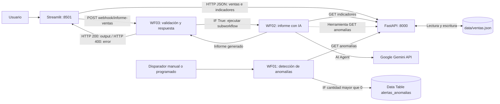
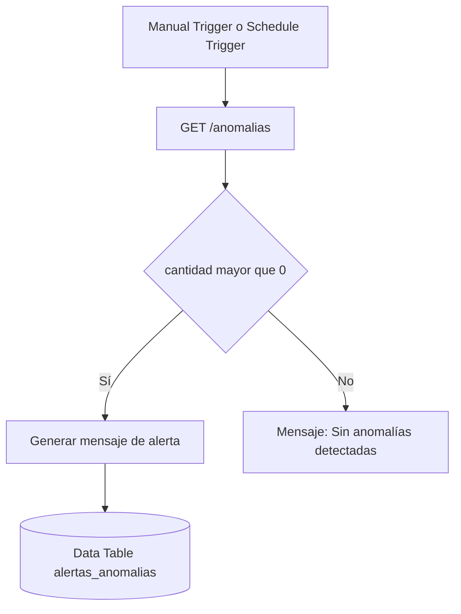
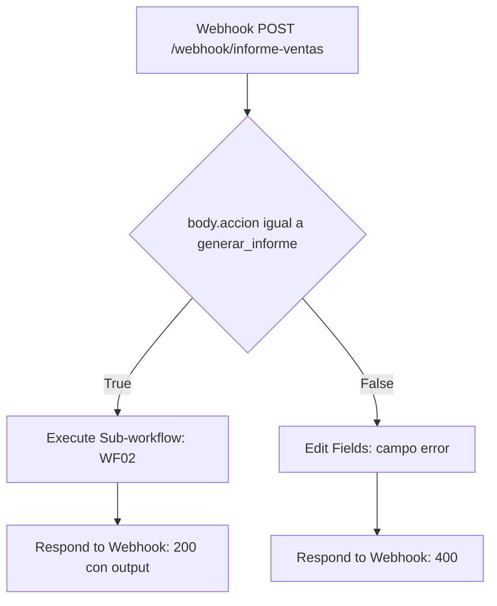

# Arquitectura — Analizador de Ventas (TP2)

**Materia:** Elementos de Programación IA y LowCode · **Proyecto:** Analizador de Ventas · **Estado:** integración funcional verificada en el laboratorio (noviembre de 2026).

Este documento actualiza la arquitectura original y describe los componentes **efectivamente implementados**. Complementa el [`README.md` principal](../../README.md) y los [workflows exportados](../n8n/workflows/).

## 1. Diagrama de arquitectura



**Ubicación de los componentes en el entorno utilizado:**

| Componente | Tecnología y responsabilidad | Dónde se ejecuta |
|---|---|---|
| Interfaz | `app_streamlit.py`: formularios, consultas, visualización e informe de IA | Proceso Python en Ubuntu, puerto `8501` |
| API | `main.py`: endpoints REST, validación Pydantic y códigos HTTP | Uvicorn / FastAPI en Ubuntu, puerto `8000` |
| Lógica | `logica.py`: cálculos, persistencia, filtros y anomalías | Mismo proceso Python que la API |
| Datos de ventas | `data/ventas.json`: almacenamiento de operaciones | Sistema de archivos de Ubuntu; solo la API accede a él |
| Automatización | n8n: WF01, WF02 y WF03 | Contenedor Docker Compose, puerto `5678` |
| Datos internos de n8n | Configuración, credenciales cifradas y Data Tables | Volumen Docker `n8n_data` |
| IA generativa | Agente de n8n conectado a Google Gemini | Servicio externo; requiere conexión a Internet y credencial propia |

> **Alcance de Docker:** el archivo [`compose.yaml`](../compose.yaml) inicia **n8n**. FastAPI y Streamlit se ejecutan en Ubuntu **fuera de Docker**. No se implementó en este TP un despliegue de los tres servicios dentro de Compose.

## 2. Recorrido de datos

1. El usuario registra, modifica, elimina, consulta o importa ventas desde **Streamlit**.
2. Streamlit realiza solicitudes **HTTP/JSON** a **FastAPI**; no lee ni modifica `ventas.json` directamente.
3. FastAPI valida los datos de entrada con **Pydantic**, invoca las funciones de `logica.py` y persiste las operaciones en `data/ventas.json`.
4. La API calcula indicadores (`GET /indicadores`) y detecta anomalías (`GET /anomalias`) mediante reglas de Python y pandas.
5. **WF01**, desde n8n, consulta `/anomalias`; si la respuesta contiene anomalías, guarda una alerta en su Data Table.
6. Cuando el usuario presiona **Generar informe con IA**, Streamlit envía un POST al webhook de **WF03** con `{"accion":"generar_informe"}`.
7. **WF03** valida `body.accion` mediante un nodo **IF**. Si es válida, invoca **WF02**, espera su finalización y devuelve el informe a Streamlit con HTTP `200`. Si no es válida, devuelve un JSON de error con HTTP `400`.
8. **WF02** consulta `/indicadores`, comprueba si existen ventas y, cuando corresponde, utiliza un **AI Agent con Gemini** para elaborar el informe. El agente dispone de una herramienta HTTP adicional para consultar `/anomalias`.

### Separación entre operaciones y análisis

- **Operaciones de ventas:** `Streamlit → FastAPI → logica.py → ventas.json`.
- **Alertas:** `WF01 → FastAPI /anomalias → IF → Data Table de n8n`.
- **Informe inteligente:** `Streamlit → WF03 → IF → WF02 → FastAPI + Gemini → WF03 → Streamlit`.

## 3. Separación reglas vs. IA

- **Python (determinista):** validación de ventas, cálculo de totales, filtros, indicadores, identificación de duplicados y detección de importes atípicos.
- **IA (generativa):** redacción del informe comercial y elaboración de recomendaciones a partir de los datos calculados por Python. No escribe ni altera las ventas almacenadas.
- **Humano:** revisa las cifras, interpretaciones y recomendaciones antes de tomar decisiones comerciales.

**Reglas concretas:** `precio` y `cantidad` deben ser mayores que cero; las ventas duplicadas se detectan por coincidencia de producto, categoría, precio y cantidad; los importes inusualmente altos se identifican mediante un límite superior de **Q3 + 3 × IQR** cuando hay al menos cuatro ventas.

La IA puede generar interpretaciones inexactas o defectos en el formato Markdown. Los resultados cuantitativos deben contrastarse con los indicadores proporcionados por la API.

## 4. Workflows n8n implementados

Los archivos JSON están en [`Proyecto/n8n/workflows/`](../n8n/workflows/). Los tres flujos tienen responsabilidades diferentes y una condición de decisión.

| # | Nombre | Disparador | Integración / responsabilidad | Decisión (IF) |
|---|---|---|---|---|
| **WF01** | Detección de Anomalías | Manual y Schedule Trigger configurado | `GET /anomalias`; genera alertas en la Data Table `alertas_anomalias` | `cantidad > 0`: registrar alerta; de lo contrario, generar mensaje sin anomalías |
| **WF02** | Informe Inteligente de Ventas | Manual o `When Executed by Another Workflow` | `GET /indicadores` → AI Agent con Gemini; herramienta disponible `GET /anomalias` | `cantidad_operaciones > 0`: generar informe solamente si hay ventas |
| **WF03** | Integración Streamlit IA | Webhook HTTP POST | Verifica la solicitud, invoca WF02 y responde a Streamlit | `body.accion == "generar_informe"`: HTTP 200; en caso contrario, HTTP 400 |

### WF01 — Detección y registro de anomalías



La tabla `alertas_anomalias` utiliza los campos `fecha` (String), `cantidad` (Number) y `mensaje_alerta` (String). **La inserción es un registro interno de n8n, no un correo electrónico ni una notificación externa.** La ejecución manual se probó; el disparador programado **no debe darse por operativo hasta publicar o habilitar la versión correspondiente**.

### WF02 — Análisis comercial mediante agente IA

El workflow obtiene los indicadores de FastAPI, verifica `cantidad_operaciones > 0` y entrega esos datos al agente de IA. Google Gemini genera el resumen, el análisis por categorías y las recomendaciones. El agente puede usar la herramienta HTTP que consulta anomalías. El nodo `When Executed by Another Workflow` permite reutilizar este mismo flujo desde WF03, sin duplicar la lógica.

**Dependencia operativa:** para que WF03 invoque WF02 en producción, la versión requerida de WF02 debe estar publicada y la referencia al subworkflow debe ser válida.

### WF03 — Webhook, validación y respuesta a Streamlit



**Solicitud válida:**

```json
{"accion":"generar_informe"}
```

**Respuesta exitosa (estructura):** HTTP `200`, JSON con el campo `output` que contiene el informe generado por el agente.

**Solicitud inválida:** una petición sin `accion` o con otro valor recorre la rama False y devuelve HTTP `400`:

```json
{"error":"Solicitud inválida: accion debe ser generar_informe"}
```

El Webhook está configurado para responder mediante nodos **Respond to Webhook**. La URL utilizada por Streamlit en Ubuntu es `http://127.0.0.1:5678/webhook/informe-ventas`. La variante `/webhook-test/` corresponde a las ejecuciones de prueba del editor de n8n, no a la integración productiva.

## 5. Comunicación, Docker y red

El contenedor n8n debe alcanzar la API que corre en el **host Ubuntu**. En [`compose.yaml`](../compose.yaml) se configuró:

```yaml
extra_hosts:
  - "host.docker.internal:host-gateway"
```

Por eso los nodos HTTP de n8n consultan `http://host.docker.internal:8000`. Para admitir esas conexiones, Uvicorn debe iniciarse con `--host 0.0.0.0`.

**URLs de los servicios dentro de Ubuntu:**

| Servicio | Dirección |
|---|---|
| FastAPI / documentación Swagger | `http://127.0.0.1:8000/docs` |
| Streamlit | `http://127.0.0.1:8501` |
| n8n | `http://127.0.0.1:5678` |
| Webhook de WF03 | `http://127.0.0.1:5678/webhook/informe-ventas` |

**Acceso desde Windows por NAT de VirtualBox, en el laboratorio utilizado:**

| Servicio | Reenvío de puertos Windows → Ubuntu |
|---|---|
| SSH | `2230 → 22` |
| FastAPI | `18000 → 8000` |
| Streamlit | `18501 → 8501` |
| n8n | `15678 → 5678` |

Esos reenvíos se configuran en VirtualBox, **no** en `compose.yaml`. El nombre `localhost` o `127.0.0.1` siempre apunta al entorno desde el cual se realiza la conexión. Si se traslada Streamlit a otro equipo o contenedor, se debe adaptar `N8N_WEBHOOK_URL`.

## 6. Persistencia y gestión de errores

- `logica.py` guarda las ventas en `data/ventas.json` mediante escritura temporal y reemplazo del archivo; las operaciones de modificación utilizan un bloqueo en el proceso de Python.
- La importación de CSV valida cada fila; las filas inválidas se informan sin impedir la incorporación de las válidas.
- FastAPI devuelve respuestas de error apropiadas: por ejemplo, HTTP `422` para datos de venta inválidos, `404` para IDs inexistentes y `500` para fallos de persistencia.
- Streamlit informa problemas de conexión y tiempos de espera de las solicitudes. Para el informe inteligente utiliza un tiempo de espera de **120 segundos**.
- WF03 rechaza solicitudes cuyo campo `accion` no sea el esperado, mediante HTTP `400`.
- La persistencia en JSON es adecuada para un prototipo académico, pero **no equivale a una base de datos transaccional multiusuario**.

## 7. Seguridad y portabilidad

- La credencial de **Google Gemini** se configura dentro de **n8n**; no debe incluirse una clave API en los archivos JSON exportados ni en Git.
- El Webhook de WF03 está **sin autenticación** en el entorno de laboratorio. La verificación de `accion` es una **validación del contenido, no un mecanismo de autenticación**.
- `N8N_SECURE_COOKIE=false` se utiliza en el laboratorio local con HTTP. No corresponde publicar esta configuración en Internet sin medidas adicionales como HTTPS, autenticación y protección del endpoint.
- Los archivos JSON de workflows **no trasladan automáticamente** credenciales, Data Tables ni referencias internas entre workflows.
- Al importar WF01 debe crearse o vincularse `alertas_anomalias`. Al importar WF03 debe seleccionarse el **WF02 de la nueva instancia** en Execute Sub-workflow. Se debe configurar también la credencial Gemini.
- Para habilitar el webhook de producción, publicar **WF02 antes de WF03**.

## 8. Verificaciones realizadas y límites

**Verificaciones manuales realizadas en el laboratorio:**

1. API disponible y consultas de `/indicadores` y `/anomalias` a través de n8n.
2. WF01: detección de anomalías y registro en la Data Table.
3. WF02: informe comercial redactado por Gemini a partir de los indicadores de la API.
4. WF03: solicitud inválida `{}` → **HTTP 400** con campo `error`.
5. WF03: solicitud válida desde Streamlit → informe mostrado correctamente (rama True, respuesta HTTP 200 esperada y corroborada en la integración).
6. Pruebas automatizadas de FastAPI mediante `pytest`, separadas de las verificaciones manuales de n8n.

**Límites conocidos:** la disponibilidad de Gemini depende de su servicio externo y de la cuota; las respuestas generativas pueden variar; el almacenamiento JSON y el Webhook sin autenticación están diseñados para la demostración académica. El Schedule Trigger de WF01 requiere su correspondiente publicación/activación para operar automáticamente.

## 9. Archivos de referencia

- [`README.md` principal](../../README.md): instalación, ejecución, dependencias, pruebas y funcionalidades.
- [`main.py`](../main.py): rutas REST, validación Pydantic y manejo de errores.
- [`logica.py`](../logica.py): cálculos, detección de anomalías y almacenamiento.
- [`app_streamlit.py`](../app_streamlit.py): formularios, consultas y botón de informe con IA.
- [`compose.yaml`](../compose.yaml): n8n en Docker y conectividad hacia FastAPI.
- [`n8n/workflows/`](../n8n/workflows/): exportaciones de WF01, WF02, WF03 e instrucciones específicas.
- [`bitacora_ia.md`](bitacora_ia.md): decisiones y dificultades del desarrollo asistido con IA.
