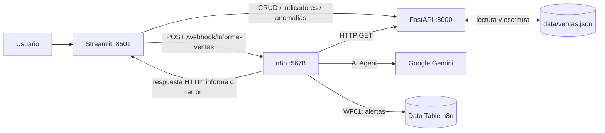

# Analizador de Ventas — TP2

Sistema integrado de análisis de ventas desarrollado con **Python (FastAPI + Streamlit)**, **n8n (Low-Code)** e **inteligencia artificial (Google Gemini mediante un agente en n8n)**. Parte del TP1 (Analizador de Ventas por consola) y permite registrar operaciones, analizar indicadores, detectar anomalías y generar informes comerciales con IA.

**Materia:** Elementos de Programación IA y LowCode · **Trabajo Práctico 2** · **2.º cuatrimestre de 2026**.

> **Estado funcional:** API REST, interfaz Streamlit, persistencia JSON, pruebas automatizadas, n8n en Docker y **tres workflows integrados** (WF01, WF02 y WF03). Se verificó la generación de informes con Gemini desde Streamlit y el rechazo de solicitudes inválidas por el webhook.
>
> **Alcance:** prototipo mínimo viable (MVP) para fines académicos. No es una aplicación preparada para exposición pública sin medidas adicionales de seguridad.

## 1. Objetivo y funcionalidades

El sistema centraliza el registro y análisis de ventas ficticias. La lógica de cálculo es **determinista y está implementada en Python**; la IA interpreta los indicadores y redacta recomendaciones, sin sustituir los resultados calculados.

- **Registrar, consultar, filtrar, editar y eliminar ventas** desde Streamlit.
- **Importar CSV**: validar cada fila, incorporar las válidas e informar las rechazadas.
- **Consultar indicadores**: cantidad de operaciones, ingresos totales, promedio por venta, producto más vendido e ingresos por categoría.
- **Detectar anomalías**: ventas duplicadas y totales atípicos mediante el rango intercuartílico (IQR).
- **Ejecutar automatizaciones en n8n** para alertas, análisis con IA e integración con la interfaz.
- **Generar un informe comercial con Gemini** desde el botón **Informe con IA** de Streamlit.

## 2. Componentes y arquitectura

| Componente | Tecnología | Puerto del servicio | Ejecución |
|---|---|---:|---|
| API REST y validaciones | FastAPI + Pydantic + Uvicorn | `8000` | Proceso Python en Ubuntu / equipo local |
| Interfaz web | Streamlit + Requests | `8501` | Proceso Python en Ubuntu / equipo local |
| Automatización y agente de IA | n8n (Docker Compose) | `5678` | Contenedor Docker |
| Modelo de IA | Google Gemini, conectado desde el nodo Chat Model de n8n | — | Servicio externo mediante credencial API |
| Persistencia de ventas | Archivo `data/ventas.json` | — | Accedido únicamente por la API |
| Persistencia de n8n | Volumen Docker `n8n_data` | — | Datos internos de n8n |



**Comunicación:** Streamlit se comunica directamente con FastAPI por HTTP/JSON para operar con las ventas. Para el informe inteligente, Streamlit llama al **webhook de WF03**, que valida la solicitud y ejecuta **WF02**; este consulta FastAPI y utiliza Gemini. **WF01** consulta las anomalías en FastAPI y registra alertas en n8n.

**Acceso desde Docker hacia FastAPI:** el contenedor utiliza `http://host.docker.internal:8000`, habilitado en Linux por `extra_hosts: host.docker.internal:host-gateway` en `compose.yaml`. FastAPI debe escuchar en `0.0.0.0`, no únicamente en `127.0.0.1`.

> El archivo `Proyecto/docs/arquitectura.md` es un documento complementario del repositorio; debe actualizarse para reflejar esta arquitectura y los workflows finales.

## 3. Requisitos

- **Python 3.10 o superior** (entorno utilizado en las pruebas: Python 3.12).
- **Git** para obtener y versionar el proyecto.
- **Docker Engine + Docker Compose** o **Docker Desktop con Compose**. No es necesario instalar Docker en el equipo Windows si se trabaja dentro de una máquina virtual Ubuntu.
- **Acceso a Internet** para usar Google Gemini, y una **clave de API válida** configurada como credencial dentro de n8n. La disponibilidad y los límites de la cuota gratuita dependen del proveedor.
- Puertos `8000`, `8501` y `5678` disponibles en el entorno donde se ejecutan los servicios.

Los paquetes Python se declaran en [`Proyecto/requirements.txt`](Proyecto/requirements.txt), incluidos FastAPI, Uvicorn, Pydantic, pandas, Streamlit, Requests, pytest y httpx.

## 4. Instalación

Los comandos siguientes se ejecutan **desde la carpeta `Proyecto/`**, donde están `main.py`, `app_streamlit.py`, `compose.yaml` y `requirements.txt`.

```bash
# Desde la raíz del repositorio clonado:
cd Proyecto

# Ubuntu/Linux: crear y activar el entorno virtual
python3 -m venv .venv
source .venv/bin/activate

# Instalar dependencias
python -m pip install -r requirements.txt
```

En Windows, si se ejecuta Python directamente en Windows, la creación y activación equivalentes son `py -m venv .venv` y `.venv\Scripts\activate` (PowerShell: `.venv\Scripts\Activate.ps1`). Para este proyecto también puede utilizarse Ubuntu en una máquina virtual, sin instalar los servicios en Windows.

## 5. Ejecución del sistema

Abrir terminales independientes **dentro de `Proyecto/`**. Para FastAPI y Streamlit, mantener activo el entorno `.venv`.

**Terminal 1 — API REST:**

```bash
uvicorn main:app --host 0.0.0.0 --port 8000
```

- Comprobar servicio: `http://localhost:8000/health`.
- Documentación interactiva **Swagger UI**: `http://localhost:8000/docs`.
- Documentación OpenAPI: `http://localhost:8000/openapi.json`.

**Terminal 2 — Streamlit:**

```bash
streamlit run app_streamlit.py --server.address 0.0.0.0 --server.port 8501
```

- Interfaz: `http://localhost:8501` desde el sistema que ejecuta la aplicación.

**Terminal 3 — n8n con Docker Compose:**

```bash
sudo docker compose up -d          # Iniciar n8n
sudo docker compose ps             # Ver estado
sudo docker compose logs -f n8n    # Ver registros (Ctrl+C para salir)
sudo docker compose restart n8n    # Reiniciar n8n
sudo docker compose down           # Detener y quitar el contenedor
```

- Editor de n8n: `http://localhost:5678`.
- `docker compose down` **no borra** el volumen persistente `n8n_data`; no usar `down -v` si se desea conservar las configuraciones y credenciales.
- Si el usuario pertenece al grupo `docker`, puede omitir `sudo`.
- El archivo [`Proyecto/compose.yaml`](Proyecto/compose.yaml) ejecuta **solo n8n**. FastAPI y Streamlit se levantan como procesos Python fuera del contenedor.

**Acceso desde Windows cuando Ubuntu se ejecuta en VirtualBox (configuración de laboratorio utilizada):**

| Servicio | Puerto Ubuntu | Redirección NAT Windows → Ubuntu | URL en Windows |
|---|---:|---:|---|
| FastAPI / Swagger UI | `8000` | `18000 → 8000` | `http://127.0.0.1:18000/docs` |
| Streamlit | `8501` | `18501 → 8501` | `http://127.0.0.1:18501` |
| n8n | `5678` | `15678 → 5678` | `http://127.0.0.1:15678` |

Estas redirecciones son **propias de la VM de desarrollo**; deben crearse en VirtualBox si se reproduce ese escenario. No forman parte de `compose.yaml`. En una ejecución local sin VM, usar los puertos originales.

## 6. Workflows de n8n

Los JSON exportados están versionados en [`Proyecto/n8n/workflows/`](Proyecto/n8n/workflows/).

| Workflow | Disparador | Operación e integración | Decisión |
|---|---|---|---|
| **WF01 — Deteccion de Anomalias** | Manual; también incluye un disparador programado | `GET /anomalias` → registra alertas en una Data Table de n8n | `IF cantidad > 0`: registrar alerta / informar que no hay anomalías |
| **WF02 — Informe Inteligente de Ventas** | Manual o `When Executed by Another Workflow` | `GET /indicadores` → AI Agent + Google Gemini; el agente dispone de una herramienta HTTP para consultar `/anomalias` | `IF cantidad_operaciones > 0`: ejecutar el agente únicamente con ventas disponibles |
| **WF03 — Integracion Streamlit IA** | Webhook HTTP `POST /webhook/informe-ventas` | Valida la solicitud, invoca WF02 como subworkflow y responde a Streamlit | `IF body.accion == "generar_informe"`: informe HTTP 200 / error HTTP 400 |

### WF01 — Alertas de anomalías

1. Consulta `http://host.docker.internal:8000/anomalias`.
2. Evalúa si existen anomalías.
3. Si las hay, genera `mensaje_alerta` y registra una fila en la **Data Table** `alertas_anomalias`.
4. Si no las hay, produce el mensaje `Sin anomalías detectadas.`.

La tabla utilizada en el entorno de desarrollo contiene las columnas `fecha` (String), `cantidad` (Number) y `mensaje_alerta` (String). **La Data Table se debe crear o vincular manualmente al importar el workflow en otra instancia de n8n.** El workflow incorpora un disparador programado diario, pero su ejecución automática requiere que la versión correspondiente esté publicada/activada; se verificó su ejecución manual.

### WF02 — Informe inteligente de ventas

Consulta los indicadores calculados por FastAPI y utiliza un **AI Agent con Google Gemini** para producir un resumen comercial, analizar categorías/productos y recomendar acciones. El agente cuenta con una herramienta HTTP para consultar anomalías. La IA **no calcula ni modifica las ventas almacenadas**: interpreta información provista por la API. Las recomendaciones requieren revisión humana.

El workflow dispone de `When Executed by Another Workflow`, necesario para la llamada desde WF03.

### WF03 — Integración Streamlit ↔ n8n ↔ IA

El botón **Generar informe con IA** de Streamlit envía al webhook de producción:

```json
{"accion": "generar_informe"}
```

- **Solicitud válida:** la rama `True` ejecuta WF02, espera su finalización y devuelve el contenido generado en el campo `output` mediante **Respond to Webhook**, con HTTP **200**.
- **Solicitud inválida:** la rama `False` genera el campo `error` y responde con HTTP **400**:

```json
{"error": "Solicitud inválida: accion debe ser generar_informe"}
```

**URL de producción en Ubuntu:** `http://127.0.0.1:5678/webhook/informe-ventas`. La ruta `/webhook-test/` solo sirve para pruebas desde el editor cuando está escuchando eventos de prueba; Streamlit utiliza `/webhook/` con WF03 publicado.

### Importar los workflows en otra instalación de n8n

1. Iniciar n8n y crear o ingresar al espacio de trabajo correspondiente.
2. Importar los archivos JSON de `Proyecto/n8n/workflows/` mediante la opción **Import from File** del editor de workflows.
3. Configurar **Google Gemini Chat Model** con una nueva credencial propia; las claves secretas **no se incluyen** en los JSON exportados. Revisar que el modelo seleccionado esté disponible con la cuenta utilizada.
4. Crear/vincular la Data Table `alertas_anomalias` y revisar el nodo de inserción de WF01.
5. Revisar las referencias de subworkflow: en WF03, seleccionar el **WF02 importado** en el nodo **Execute Sub-workflow**. Los identificadores entre instancias pueden diferir.
6. Verificar que los nodos HTTP apunten a la API accesible **desde el contenedor** (`http://host.docker.internal:8000` con la configuración de Compose incluida).
7. Publicar **primero WF02** y luego **WF03** para habilitar la ejecución anidada y el webhook de producción. Publicar/habilitar WF01 si se desea ejecutar su programación automática.
8. Ejecutar una prueba de extremo a extremo desde Streamlit y revisar las ejecuciones en n8n.

> **Portabilidad:** importar un JSON no reproduce automáticamente credenciales, datos internos de n8n, Data Tables ni todas las referencias entre workflows. Estas configuraciones deben verificarse en la instancia de destino.

## 7. Endpoints de FastAPI

| Método | Ruta | Descripción | Respuestas de error relevantes |
|---|---|---|---|
| `POST` | `/ventas` | Registrar una venta | `422` |
| `GET` | `/ventas?producto=&categoria=` | Listar y filtrar | `500` ante error de persistencia |
| `GET` | `/ventas/{id_venta}` | Obtener una venta por ID | `404` |
| `PUT` | `/ventas/{id_venta}` | Modificar una venta | `404`, `422` |
| `DELETE` | `/ventas/{id_venta}` | Eliminar una venta | `404` |
| `POST` | `/ventas/importar` | Importar filas; informa aceptadas y rechazadas | `422` para solicitud inválida |
| `GET` | `/indicadores` | Operaciones, ingresos, promedio, producto/categoría líder | `500` ante error de persistencia |
| `GET` | `/anomalias` | Ventas duplicadas y valores atípicos (IQR) | `500` ante error de persistencia |
| `GET` | `/health` | Estado del servicio | — |

Los esquemas **Pydantic** validan campos obligatorios, precios positivos y cantidades mayores que cero. La lógica de negocio está separada de los controladores en `logica.py`. Consultar los contratos exactos y ejemplos en **Swagger UI** (`/docs`).

## 8. Configuración y variables de entorno

| Variable | Uso | Valor predeterminado |
|---|---|---|
| `API_URL` | URL utilizada por Streamlit para llamar a FastAPI | `http://localhost:8000` |
| `N8N_WEBHOOK_URL` | URL utilizada por Streamlit para solicitar informes | `http://127.0.0.1:5678/webhook/informe-ventas` |
| `VENTAS_PATH` | Ruta de persistencia utilizada por `logica.py` | `data/ventas.json` junto a los módulos Python |

Las variables son **opcionales** en el entorno de desarrollo descripto. Ejemplo en Ubuntu, antes de lanzar Streamlit:

```bash
export API_URL="http://127.0.0.1:8000"
export N8N_WEBHOOK_URL="http://127.0.0.1:5678/webhook/informe-ventas"
```

Si Streamlit se despliega dentro de otro contenedor o en otra máquina, `127.0.0.1` se refiere a **ese** entorno, no al contenedor de n8n; adaptar la variable `N8N_WEBHOOK_URL` y la conectividad de red.

### Seguridad

- **No subir** claves API, contraseñas, tokens ni credenciales privadas al repositorio.
- Configurar la clave de Google Gemini **dentro del gestor de credenciales de n8n**. Los JSON exportados no deberían incluirla; revisar los archivos antes de cada commit.
- El archivo `.gitignore` excluye `.env`, `.venv/` y cachés. La configuración actual no requiere copiar un `.env.example` para ejecutar las funciones principales.
- `compose.yaml` configura `N8N_SECURE_COOKIE=false` para el laboratorio HTTP local. **No exponer esta configuración ni el webhook sin autenticación a Internet**. Para despliegue público se requieren HTTPS, autenticación y medidas de seguridad adicionales.

## 9. Pruebas y verificación

**Pruebas automatizadas de la API:**

```bash
python -m pytest -q
```

El conjunto incluido en `tests/test_api.py` verifica consultas, filtros, creación, validaciones, actualización, eliminación, importación, indicadores, anomalías y fallos de persistencia. Los tests trabajan con una copia temporal de `data/ventas.json`.

> **Importante:** varias aserciones esperan el dataset de ejemplo original con **14 ventas**. Si se modifica `data/ventas.json`, esas pruebas pueden dejar de coincidir con los valores esperados. Mantener los datos de referencia para reproducirlas; no incluir cambios de pruebas manuales en Git por accidente.

**Comprobación rápida de la API:**

```bash
curl http://127.0.0.1:8000/health
```

Respuesta esperada: `{"estado":"ok"}`.

**Comprobar WF03, rama False (solicitud inválida):**

```bash
curl -i -X POST http://127.0.0.1:5678/webhook/informe-ventas \
  -H 'Content-Type: application/json' \
  -d '{}'
```

Respuesta esperada: **HTTP 400** con un JSON que contiene el campo `error`.

**Comprobar WF03, rama True (solicitud válida):**

```bash
curl -i -X POST http://127.0.0.1:5678/webhook/informe-ventas \
  -H 'Content-Type: application/json' \
  -d '{"accion":"generar_informe"}'
```

Respuesta esperada: **HTTP 200** con un JSON que contiene `output` y el informe de Gemini (requiere WF02, Gemini y FastAPI operativos). También se puede verificar desde **Streamlit → Informe con IA → Generar informe con IA**.

**Verificaciones de integración realizadas en el laboratorio:** ejecución de los tres workflows, informe de Gemini mostrado en Streamlit, rechazo de solicitud inválida con HTTP 400 y ejecución exitosa de la solicitud válida. Estas comprobaciones de integración se realizaron manualmente; no forman parte de las pruebas automáticas de `pytest`.

## 10. Datos de ejemplo

- `data/ventas.json` contiene **14 operaciones ficticias** en la versión de referencia. Incluye dos ventas idénticas de **Televisor** para demostrar detección de duplicados y valores atípicos.
- `data/ventas_nuevas.csv` contiene ventas válidas y una fila con **precio negativo** para probar la importación parcial y los mensajes de error.
- Las operaciones de alta, modificación, eliminación o importación cambian el archivo `data/ventas.json` local. Es recomendable conservar una copia del dataset original antes de realizar demostraciones.

## 11. Estructura del proyecto

```text
Grupo2_TP2_E_Prog_IA_LC/
├── README.md                       # Documentación principal del repositorio
└── Proyecto/
    ├── main.py                         # API FastAPI: endpoints y esquemas Pydantic
    ├── logica.py                       # Persistencia JSON, reglas y análisis con pandas
    ├── app_streamlit.py                # Interfaz, operaciones e informe con IA
    ├── compose.yaml                    # Contenedor n8n y red hacia FastAPI
    ├── requirements.txt                # Dependencias Python
    ├── .gitignore                      # Exclusiones de Git
    ├── data/
    │   ├── ventas.json                 # Dataset de ejemplo
    │   └── ventas_nuevas.csv           # CSV de prueba
    ├── n8n/
    │   └── workflows/
    │       ├── WF01_Deteccion_Anomalias.json
    │       ├── WF02_Informe_Inteligente_Ventas.json
    │       ├── WF03_Integracion_Streamlit_IA.json
    │       └── README.md               # Notas de importación de workflows
    ├── docs/
    │   ├── arquitectura.md             # Diagrama / documentación de arquitectura
    │   ├── bitacora_ia.md              # Uso y decisiones de IA
    │   └── responsabilidades.md        # Responsabilidades por integrante
    └── tests/
        └── test_api.py                 # Pruebas de FastAPI
```

## 12. Reproducibilidad y límites conocidos

- El prototipo utiliza **persistencia JSON local**: adecuada para el TP, pero no reemplaza una base de datos multiusuario ni un almacenamiento transaccional para producción.
- La IA puede producir redacciones o recomendaciones imprecisas. Los indicadores provienen de FastAPI y deben contrastarse con los datos; las decisiones relevantes requieren **supervisión humana**.
- Gemini depende de Internet, la disponibilidad del servicio y los límites de la cuota de la credencial configurada.
- La ejecución programada de WF01 requiere publicación/activación; no debe confundirse la presencia del nodo Schedule con una garantía de ejecución diaria.
- La reproducción en otra instancia requiere importar workflows y **reconfigurar referencias y credenciales** de n8n (ver sección 6).
- Los documentos `Proyecto/docs/arquitectura.md` y `Proyecto/docs/bitacora_ia.md` se mantienen como entregables complementarios y requieren incorporar las últimas decisiones de integración de n8n/Gemini.

---

**Repositorio del equipo:** [Grupo2_TP2_E_Prog_IA_LC](https://github.com/Marian2057/Grupo2_TP2_E_Prog_IA_LC) · **Rama de desarrollo de esta integración:** `RamaDeCarlos`.
